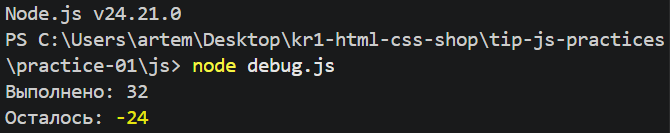
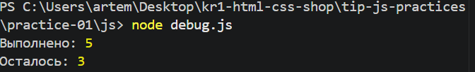
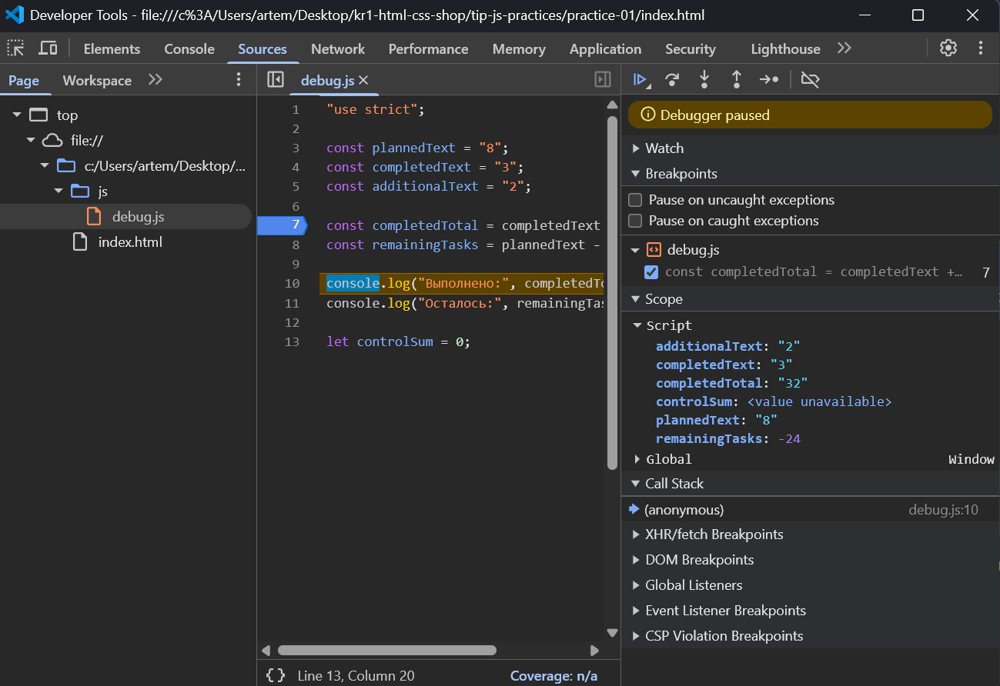

# Практическая работа № 1 — JavaScript

## 1. Автор и вариант

**Студент:** Баранов Артём
**Группа:** ЭФБО-03-25
**Вариант:** 3

## 2. Окружение

* **Операционная система:** Windows
* **Node.js:** v24.21.0
* **npm:** используется через `npm.cmd` из-за ограничения PowerShell на запуск `npm.ps1`
* **Git:** установлен и используется для работы с репозиторием
* **Браузер:** Firefox
* **Редактор:** Visual Studio Code

## 3. Запуск

### Запуск через Node.js

Команды выполняются из корня репозитория:

```bash
node practice-01/js/hello.js
node practice-01/js/types.js
node practice-01/js/progress.js
node practice-01/js/plan.js
node practice-01/js/debug.js
```

### Запуск в браузере

1. Открыть файл `practice-01/index.html` в браузере.
2. В `index.html` указать нужный JavaScript-файл в атрибуте `src` элемента `<script>`.
3. Сохранить изменения и перезагрузить страницу.
4. Открыть DevTools и перейти во вкладку **Console**.
5. Проверить результат выполнения программы.

## 4. Задание 1 — запуск JavaScript в разных средах

Для проверки файл `hello.js` был запущен в двух средах: Node.js и браузере.

### Результат в Node.js

```text
Студент: Баранов Артём
Группа: ЭФБО-03-25
Практическая работа: 1
JavaScript успешно запущен
Тип document: undefined
```

### Результат в браузере

В браузере программа была запущена через `index.html`. Результат выполнения проверен в DevTools во вкладке **Console**.

## 5. Задание 2 — типы и преобразования

В задании были проверены десять выражений. Перед запуском для каждого выражения был определён предполагаемый результат, после чего результат и его тип были проверены с помощью `console.log()`.

|  № | Выражение          | Ожидаемый результат | Фактический результат | Тип результата | Объяснение                                                                                                     |
| -: | ------------------ | ------------------- | --------------------- | -------------- | -------------------------------------------------------------------------------------------------------------- |
|  1 | `"8" + 2`          | `82`                | `82`                  | `string`       | Оператор `+` при наличии строки выполняет конкатенацию.                                                        |
|  2 | `"8" - 2`          | `6`                 | `6`                   | `number`       | При вычитании строка `"8"` преобразуется в число.                                                              |
|  3 | `Number("8") + 2`  | `10`                | `10`                  | `number`       | `Number("8")` явно преобразует строку в число.                                                                 |
|  4 | `"12" > "3"`       | `false`             | `false`               | `boolean`      | Две строки сравниваются лексикографически. `"1"` меньше `"3"`.                                                 |
|  5 | `12 === "12"`      | `false`             | `false`               | `boolean`      | Строгое сравнение учитывает и значение, и тип.                                                                 |
|  6 | `Number("")`       | `0`                 | `0`                   | `number`       | Пустая строка при преобразовании в число становится `0`.                                                       |
|  7 | `Number("text")`   | `NaN`               | `NaN`                 | `number`       | Строка не может быть преобразована в корректное число, поэтому получается `NaN`.                               |
|  8 | `Boolean("false")` | `true`              | `true`                | `boolean`      | Непустая строка является истинным значением.                                                                   |
|  9 | `typeof null`      | `"object"`          | `"object"`            | `string`       | `typeof` возвращает строку с названием типа; результат `"object"` для `null` является особенностью JavaScript. |
| 10 | `typeof NaN`       | `"number"`          | `"number"`            | `string`       | `NaN` относится к типу `number`, а `typeof` возвращает строку `"number"`.                                      |

Все десять выражений были проверены в Node.js и браузере.

## 6. Задания 3 и 4 — расчёт прогресса и планирование

### Задание 3 — расчёт прогресса

Для демонстрации варианта использовались значения:

* `totalTasks = 9`
* `completedTasks = 9`

Были дополнительно выполнены обязательные проверки корректности входных данных.

| Проверка                       | Входные данные | Ожидаемый результат                 | Фактический результат                       | Итог     |
| ------------------------------ | -------------- | ----------------------------------- | ------------------------------------------- | -------- |
| Вариант 3                      | `9, 9`         | 0 оставшихся, `100.0%`, `Завершено` | 0 оставшихся, `100.0%`, `Завершено`         | Пройдено |
| Обычный случай                 | `12, 5`        | 7 оставшихся, `41.7%`, `В работе`   | 7 оставшихся, `41.7%`, `В работе`           | Пройдено |
| Нет задач                      | `0, 0`         | `Задач пока нет`                    | `Задач пока нет`                            | Пройдено |
| Ничего не выполнено            | `5, 0`         | 5 оставшихся, `0.0%`, `Не начато`   | 5 оставшихся, `0.0%`, `Не начато`           | Пройдено |
| Всё выполнено                  | `5, 5`         | 0 оставшихся, `100.0%`, `Завершено` | 0 оставшихся, `100.0%`, `Завершено`         | Пройдено |
| Выполнено больше существующего | `5, 6`         | Сообщение об ошибке                 | `Ошибка: выполнено больше, чем существует.` | Пройдено |
| Отрицательное значение         | `-1, 0`        | Сообщение об ошибке                 | Сообщение об ошибке                         | Пройдено |
| Дробное значение               | `5, 2.5`       | Сообщение об ошибке                 | Сообщение об ошибке                         | Пройдено |
| Строковое значение             | `"5", 2`       | Сообщение об ошибке                 | Сообщение об ошибке                         | Пройдено |
| Превышение верхней границы     | `1001, 0`      | Сообщение об ошибке                 | Сообщение об ошибке                         | Пройдено |
| Некорректное числовое значение | `NaN, 0`       | Сообщение об ошибке                 | Сообщение об ошибке                         | Пройдено |

### Задание 4 — планирование выполнения задач

Для демонстрации варианта использовались значения:

* `totalTasks = 9`
* `completedTasks = 9`
* `dailyLimit = 3`

Также были выполнены обязательные проверки цикла и валидации входных данных.

| Проверка                       | Входные данные | Ожидаемый результат                      | Фактический результат            | Итог     |
| ------------------------------ | -------------- | ---------------------------------------- | -------------------------------- | -------- |
| Вариант 3                      | `9, 9, 3`      | 0 дней                                   | 0 дней, все задачи выполнены     | Пройдено |
| Обычный случай                 | `12, 5, 3`     | 3 дня, последний день — 1 задача         | 3 дня, последний день — 1 задача | Пройдено |
| Полное выполнение за 2 дня     | `10, 4, 3`     | 2 дня                                    | 2 дня                            | Пройдено |
| Лимит больше остатка           | `5, 3, 10`     | 1 день, 2 задачи                         | 1 день, 2 задачи                 | Пройдено |
| Все задачи выполнены           | `5, 5, 2`      | 0 дней, цикл не запускается              | 0 дней, цикл не запускается      | Пройдено |
| Задач нет                      | `0, 0, 2`      | 0 дней, цикл не запускается              | 0 дней, цикл не запускается      | Пройдено |
| Нулевой лимит                  | `5, 2, 0`      | Сообщение об ошибке, цикл не запускается | Сообщение об ошибке              | Пройдено |
| Дробный лимит                  | `5, 2, 1.5`    | Сообщение об ошибке                      | Сообщение об ошибке              | Пройдено |
| Выполнено больше существующего | `5, 6, 2`      | Сообщение об ошибке                      | Сообщение об ошибке              | Пройдено |
| Строковый лимит                | `5, 2, "2"`    | Сообщение об ошибке                      | Сообщение об ошибке              | Пройдено |
| Превышение лимита              | `5, 2, 1001`   | Сообщение об ошибке                      | Сообщение об ошибке              | Пройдено |

## 7. Отладка

Для отладки использовался файл `debug.js`. Сначала была проверена исходная версия программы с ошибкой преобразования типов.

### Исходный результат

В исходном коде значения были заданы как строки:

```javascript
const plannedText = "8";

const completedText = "3";

const additionalText = "2";

const completedTotal = (completedText) + (additionalText);

const remainingTasks = plannedText - completedTotal;

console.log("Выполнено:", completedTotal);

console.log("Осталось:", remainingTasks);

let controlSum = 0;
```

При сложении строк `"3"` и `"2"` оператор `+` выполняет конкатенацию строк, поэтому вместо арифметического сложения получается:

```text
"3" + "2" → "32"
```

В результате программа выводила:

```text
Выполнено: 32
Осталось: -24
```



### Причина ошибки

Ошибка возникла из-за особенностей преобразования типов в JavaScript. Переменные `completedText` и `additionalText` содержали строки, поэтому оператор `+` объединил их в строку `"32"` вместо получения числа `5`.

При вычитании JavaScript автоматически преобразовал строковое значение в число, поэтому:

```text
8 - 32 = -24
```

### Исправление

Для явного преобразования строковых значений в числа была использована функция `Number()`:

```javascript
const completedTotal = Number(completedText) + Number(additionalText);

const remainingTasks = Number(plannedText) - completedTotal;
```

После преобразования значения обрабатываются как числа:

```text
3 + 2 = 5
8 - 5 = 3
```

### Результат после исправления

После внесения исправления программа выводит:

```text
Выполнено: 5
Осталось: 3
```



### Точка останова

Для дополнительной проверки работы программы была использована точка останова в Visual Studio Code.

В момент остановки выполнения были проверены значения переменных:

```text
completedTotal = 5
remainingTasks = 3
```

Точка останова позволила убедиться, что после преобразования строк в числа переменные содержат ожидаемые значения.



## 8. Вывод

В ходе практической работы были освоены основы JavaScript: запуск программ в Node.js и браузере, работа с переменными и типами данных, преобразование типов, использование операторов сравнения и арифметических операторов, а также вывод результатов с помощью `console.log()`.

В заданиях на расчёт прогресса и планирование были реализованы проверки входных данных, условные конструкции и циклы. Дополнительно была проведена отладка программы с использованием точки останова в Visual Studio Code.

Наиболее показательной оказалась ошибка в `debug.js`, связанная с оператором `+`. Из-за того, что значения были строками, вместо сложения произошло их объединение: `"3" + "2"` дало `"32"`. Использование `Number()` позволило явно преобразовать строки в числа и получить правильный результат.

Практическая работа помогла лучше понять особенности динамической типизации JavaScript и необходимость контролировать типы данных при выполнении арифметических операций.
